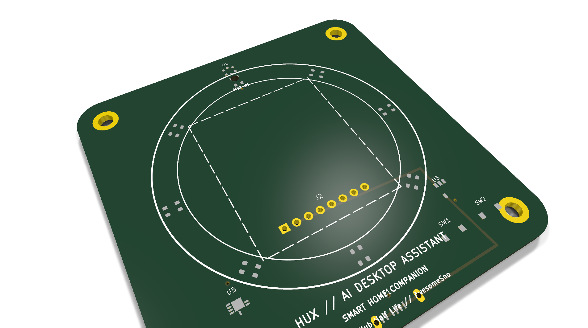
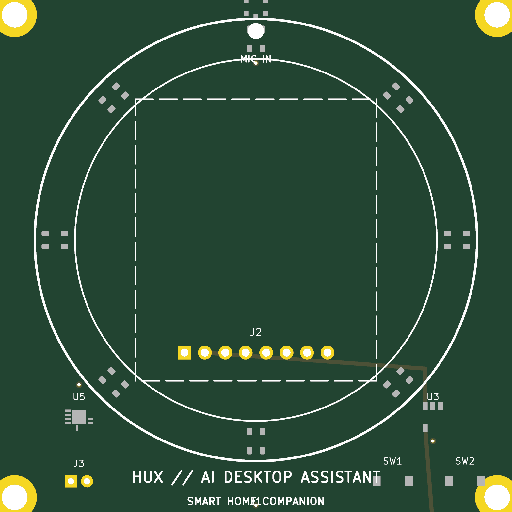
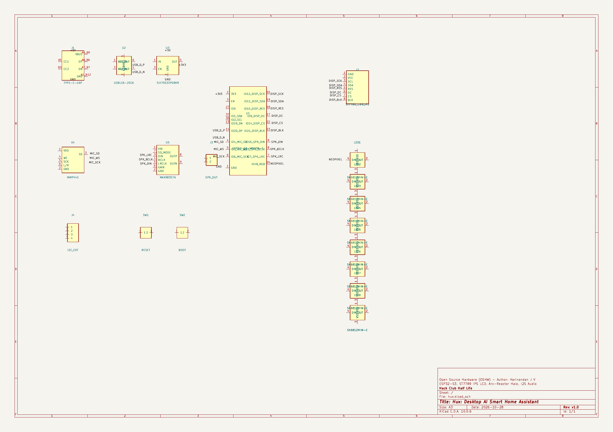

# Hux

A compact, desktop AI smart home assistant inspired by Jarvis from Iron Man. Hux features an animated digital face, real-time status display, voice interaction, and native integration with Home Assistant to control your home with personality.

---

## What is Hux?

Most smart home voice hubs are boring black cylinders with no personality or visual life. Hux is designed to bring a vivid, expressive desktop companion to your desk without spending hundreds of dollars.

Built around an ESP32-S3 microcontroller, Hux sits on your desk displaying an expressive animated face with reactive eye states (idle, listening, processing, speaking, alert). When you speak to Hux or trigger smart automations, it talks back with custom personality, controls your Home Assistant entities (lights, media, switches, climate), and dynamically switches its screen to display live device cards, weather, or room telemetry.

---

## Key Features

- **Expressive Face & HUD Display**: A crisp IPS color screen showing reactive eye animations, facial expressions, and dynamic dashboard cards for home devices.
- **Conversational Voice Persona**: Low-latency voice interaction paired with LLM or local Home Assistant Assist pipelines for responsive, witty interaction.
- **Home Assistant Native**: Direct communication with Home Assistant via WebSockets and REST APIs for zero-cloud, instant local device control.
- **Full Voice Pipeline**: Onboard digital I2S MEMS microphone for wake-word and voice pickup, paired with an I2S DAC amplifier and speaker for clear voice output.
- **Arc-Reactor Status Halo**: Circular 8x addressable RGB NeoPixel ring encircling the display bezel for glowing status cues.
- **Budget-Conscious (<$65)**: Spec'd specifically to remain under the Hack Club Half Life $65 limit, including PCB fabrication, all BOM components, taxes, and shipping.

---

## Hardware Architecture

| Component | Part / Spec | Role |
|---|---|---|
| **MCU** | ESP32-S3-WROOM-1 (16MB Flash, 8MB PSRAM) | Dual-core 240MHz controller with Wi-Fi & BLE |
| **Display** | 1.69" or 2.0" ST7789 IPS SPI LCD (240×280) | Expressive animated face & smart home telemetry HUD |
| **Microphone** | INMP441 I2S Digital MEMS Mic | High-SNR voice input with acoustic front port |
| **Audio Out** | MAX98357A I2S Class-D DAC + 3W 4Ω Speaker | Voice synthesis and feedback playback |
| **Halo Lighting** | 8x SK6812 MINI-E Addressable RGB LEDs | Arc Reactor circular aura / voice activity glow |
| **Power & Circuit** | USB-C 16-pin, TLV75533 3.3V LDO, USBLC6-2SC6 ESD | Stable desktop USB 5V power and transient protection |
| **Dimensions** | 72mm × 72mm × 1.6mm FR4 (6mm corner radii) | Standard M3 standoff mounting holes |

---

## Schematic & KiCad Design

The hardware is designed as a clean 2-layer PCB in KiCad 10:

All hardware design and manufacturing files are located in [`kicad/`](kicad/):
- Full Project: [`kicad/hux.kicad_pro`](kicad/hux.kicad_pro)
- Schematic: [`kicad/hux.kicad_sch`](kicad/hux.kicad_sch) (Printable: [`kicad/hux_schematic.pdf`](kicad/hux_schematic.pdf))
- PCB Layout: [`kicad/hux.kicad_pcb`](kicad/hux.kicad_pcb)
- Bill of Materials: [`kicad/bom.csv`](kicad/bom.csv) (JLCPCB pre-formatted with LCSC parts)
- Pick & Place: [`kicad/cpl.csv`](kicad/cpl.csv)
- Production Gerbers: [`kicad/hux_gerbers.zip`](kicad/hux_gerbers.zip)

---

## Components & Bill of Materials

| Item | Part / Designation | Supplier Code (LCSC / Mfg) | Package | Qty | Role |
|---|---|---|---|---|---|
| **Microcontroller** | ESP32-S3-WROOM-1-N16R8 | LCSC: C5180337 | SMD Module | 1 | 240MHz dual-core MCU, 16MB Flash, 8MB PSRAM, Wi-Fi & BLE |
| **Color IPS Display** | ST7789 1.69" / 2.0" IPS LCD | LCSC: C2903565 / ST7789V | 8-Pin Header / SPI | 1 | Expressive face animations & telemetry dashboard |
| **Digital MEMS Mic** | INMP441 | LCSC: C444583 | SMD Acoustic | 1 | Omnidirectional I2S microphone for voice commands |
| **Audio Amplifier** | MAX98357AETE+T | LCSC: C268261 | QFN-16 | 1 | 3.2W Mono Class-D I2S DAC amplifier |
| **Micro Speaker** | 4Ω 3W Cavity Speaker | JST-PH 2.0mm / C131337 | 28mm / 31mm | 1 | Voice responses and sound effects |
| **Arc-Reactor Halo** | SK6812 MINI-E | LCSC: C2890040 | SMD-3535 | 8 | Circular addressable RGB NeoPixels for status cues |
| **Voltage Regulator** | TLV75533PDBVR | LCSC: C397683 | SOT-23-5 | 1 | Low-dropout 3.3V 500mA LDO regulator |
| **ESD Protection** | USBLC6-2SC6 | LCSC: C7519 | SOT-23-6 | 1 | High-speed USB D+/D- transient ESD suppressor |
| **USB-C Receptacle** | TYPE-C-31-M-12 (16-Pin) | LCSC: C165948 | 16-Pin SMD | 1 | 5V DC power and native USB-CDC programming |
| **Tactile Buttons** | TL3342F160QG | LCSC: C318884 | SMD SPST | 2 | Hardware Reset (EN) and Bootloader (IO0) |
| **Ceramic Capacitors** | 10µF 16V X7R (0805) | LCSC: C15849 | 0805 | 3 | Bulk power input/output filters |
| **Decoupling Caps** | 100nF 50V X7R (0805) | LCSC: C14663 | 0805 | 11 | IC supply decoupling & LED smoothing |
| **Resistors** | 5.1kΩ 1% (0805) | LCSC: C17704 | 0805 | 2 | USB-C CC1/CC2 5V pull-downs |
| **Resistors** | 10kΩ 1% (0805) | LCSC: C17414 | 0805 | 3 | Pull-ups for EN, BOOT, SD_MODE |
| **Resistors** | 330Ω 1% (0805) | LCSC: C17632 | 0805 | 1 | NeoPixel DIN data line protection |
| **Telemetry Header** | 4-Pin 2.54mm Header | LCSC: C22548 | 1x04 P2.54mm | 1 | I2C sensor expansion (SDA, SCL, 3V3, GND) |

---

## Author

Designed and built by **Harinandan J V** ([@AwesomeSno](https://github.com/AwesomeSno)) for Hack Club's Half Life.
