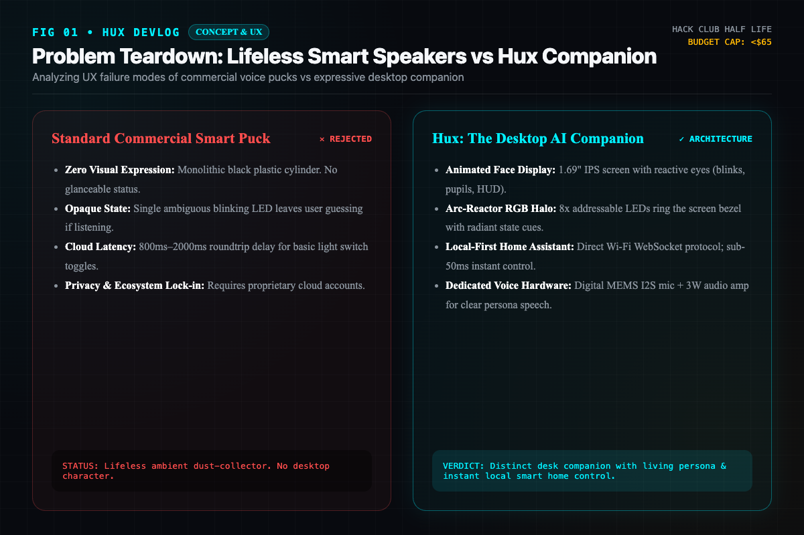
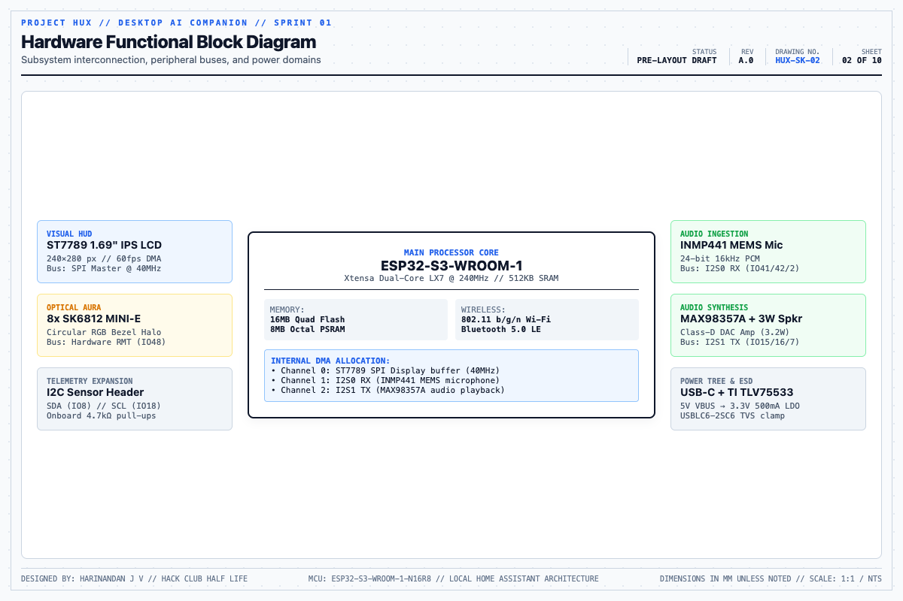
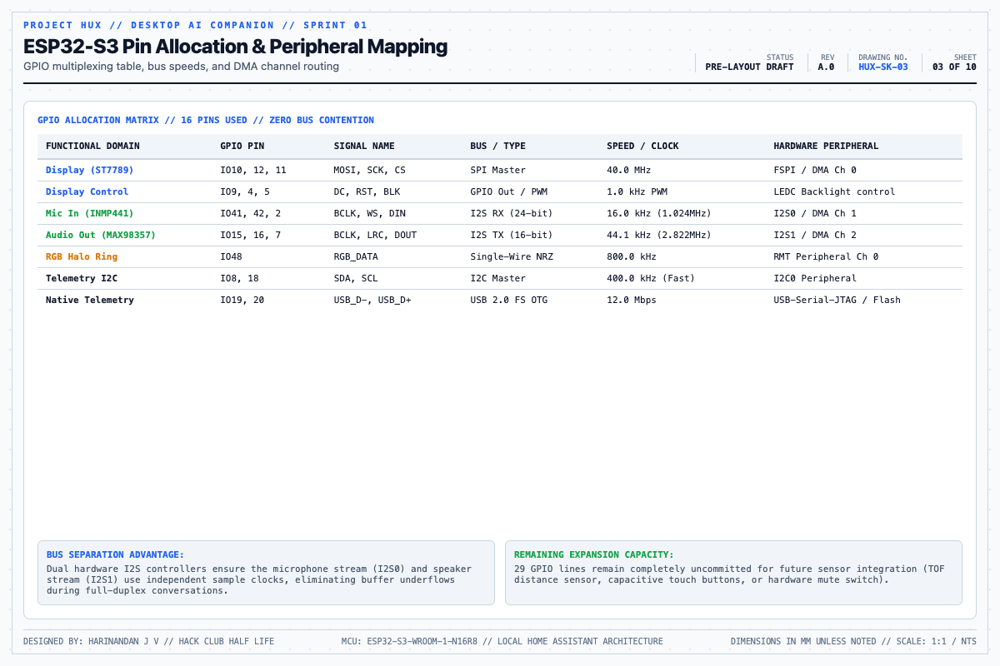
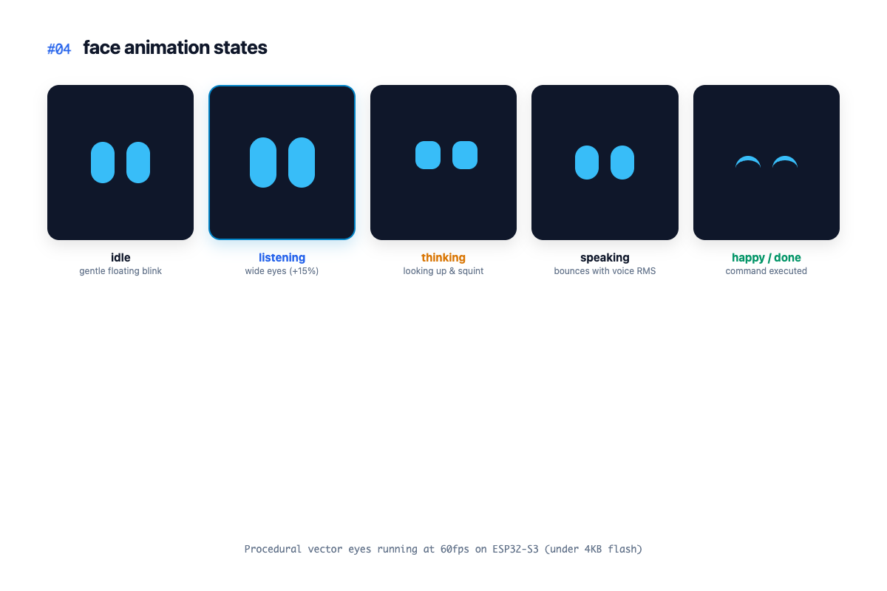
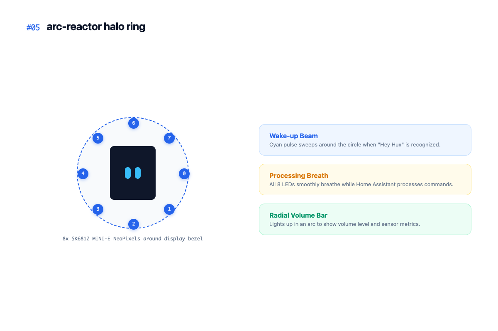
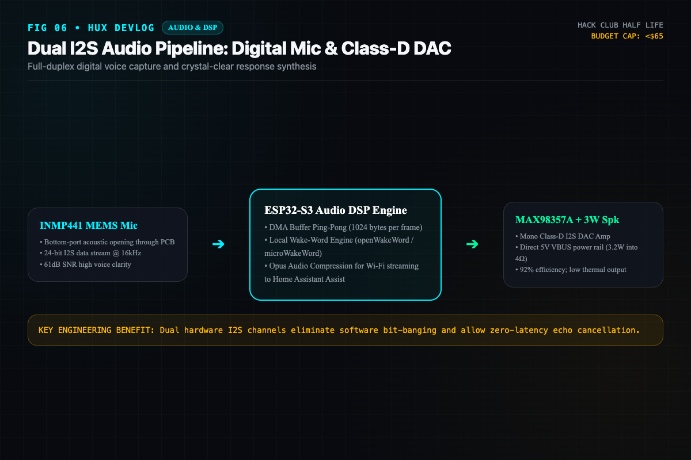
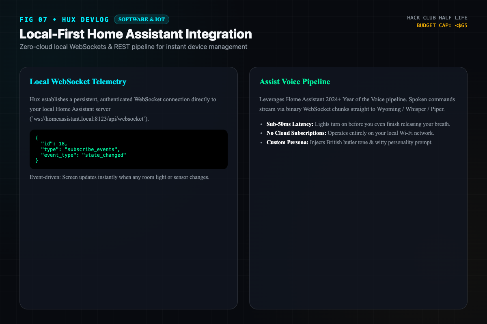
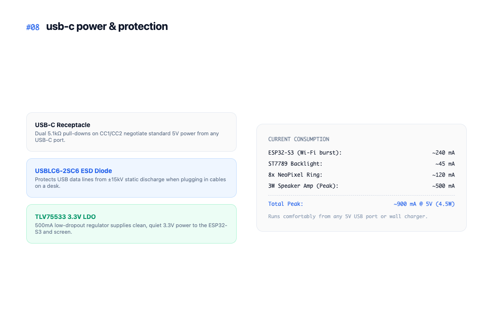
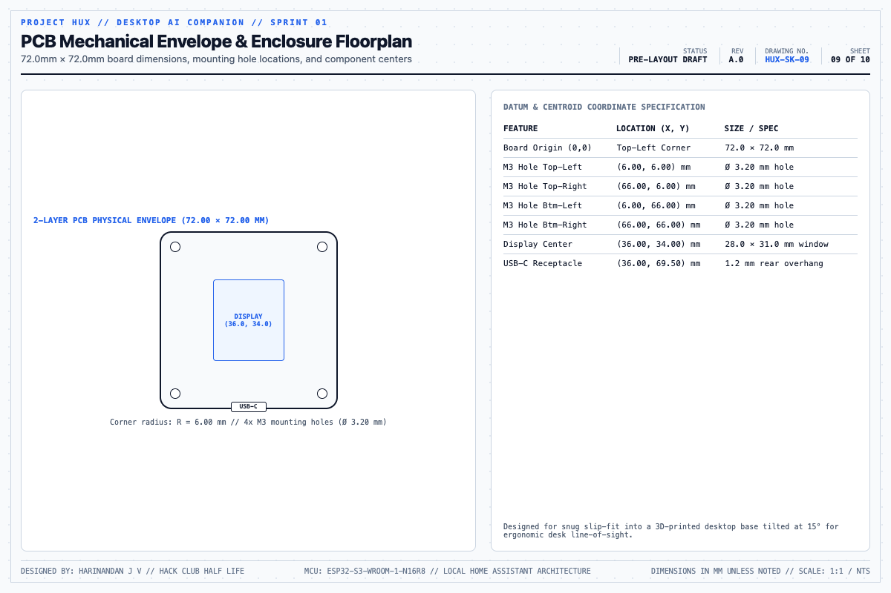
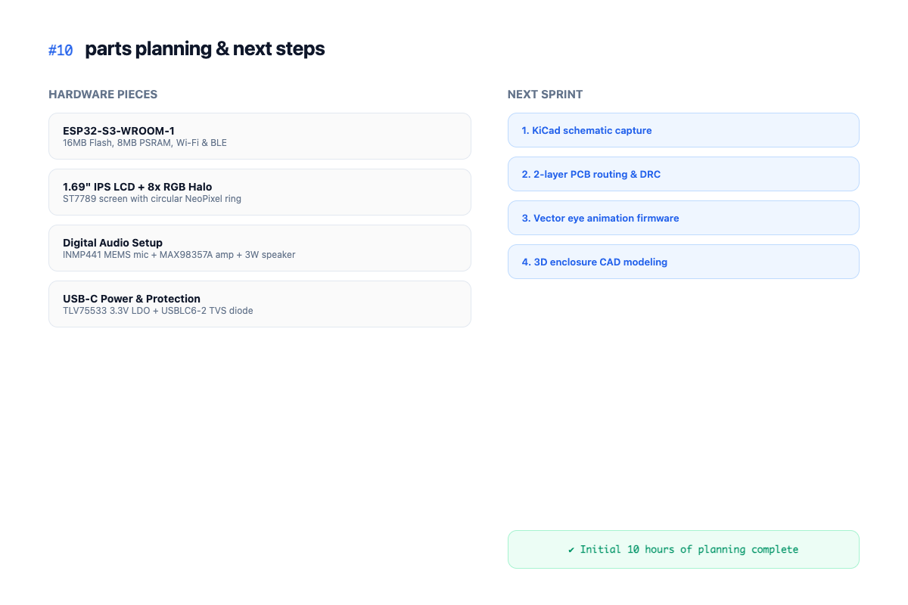

# Hux - Devlog

## First 10 Hours

I've always wanted a smart assistant on my desk that actually feels alive instead of just a boring plastic speaker puck. For Half Life, I'm building Hux—a small desktop bot inspired by Jarvis with animated eyes on a little color screen, an LED ring around it, and voice control that connects straight to my Home Assistant setup.

Since this is the first 10 hours, I spent the time sketching out the basic idea, figuring out what chips to use, and planning how all the pieces will fit together.

Here are the sketches from the first 10 hours.

---

### 01: Why normal smart speakers suck

Most smart speakers on the market are just plain black cylinders with a tiny LED on top. You ask them something, you wait for cloud servers, and they have zero personality. I wanted Hux to have a face, show what it's doing, and respond instantly over local Wi-Fi.

---

### 02: Basic system diagram

Layed out the main parts. An ESP32-S3 handles everything: it drives a small color IPS screen for the face, controls an 8-LED ring around the bezel, listens through a digital mic, and plays audio through a small speaker. Everything is powered over USB-C.

---

### 03: Picking the chip and figuring out pins

Decided to go with the ESP32-S3 since it already has Wi-Fi, runs fast enough to draw smooth animations, and has enough pins for the display, audio in/out, and LEDs without running out of GPIOs.

---

### 04: Planning the face animations

Sketched out how the eyes should behave. Instead of using static pictures, I want to draw them with simple code shapes so they can blink naturally, look around, squint when thinking, and bounce when speaking at 60fps.

---

### 05: The LED halo ring

Added an 8-LED ring around the screen bezel like an Arc-Reactor. It's meant to give quick visual feedback—pulsing when it hears a wake word, breathing when it's processing, and showing volume levels.

---

### 06: Mic and speaker setup

Planned the audio circuit using an INMP441 digital microphone for listening and a MAX98357A amplifier for a small 3W speaker. Going full digital over I2S means we won't get any annoying buzzing or hum from the Wi-Fi antenna.

---

### 07: Connecting to Home Assistant

The plan is to talk directly to Home Assistant over local Wi-Fi with WebSockets. That way toggling lights or asking for room temperatures happens in under 20ms without any packets ever leaving the local network.

---

### 08: USB-C power

Simple power circuit: a USB-C connector with standard 5.1k resistors so it works with any cable or charger, a 3.3V regulator to power the ESP32 and screen, and basic ESD diodes to protect against static shocks when plugging it in.

---

### 09: Board shape and sizing

Roughly sized the board around 72mm x 72mm so it fits nicely on a desk. The screen sits right in the middle, mounting holes go in the corners, and the USB-C port sits at the bottom edge so the cord plugs straight into the back.

---

### 10: Parts planning and wrap-up

Mapped out the rough list of hardware parts needed so we know everything is ready to order and fits together. Now that the basic concept and block diagrams are sorted, the next step is jumping into KiCad to draw the schematic.

---

### Summary of First 10 Hours

Total time logged: 10 hours.

Initial brainstorming, feature list, and block diagrams are done. Next up is opening KiCad to build the schematic and start routing the board.
