# Hux - Devlog

## Hours 11 - 25

After wrapping up the initial planning and block diagrams in the first 10 hours, I spent the next 15 hours capturing the full KiCad schematic, routing the 2-layer board, running DRC checks, exporting JLCPCB fabrication files, and writing the display and audio drivers.

Here is the breakdown of what I worked on:

---

### Hour 11: KiCad schematic setup and MCU power

Set up the KiCad project. Added the ESP32-S3-WROOM-1 symbol, wired up the decoupling caps, and added the USB-C port with standard 5.1k pull-downs and the TLV75533 3.3V LDO regulator.

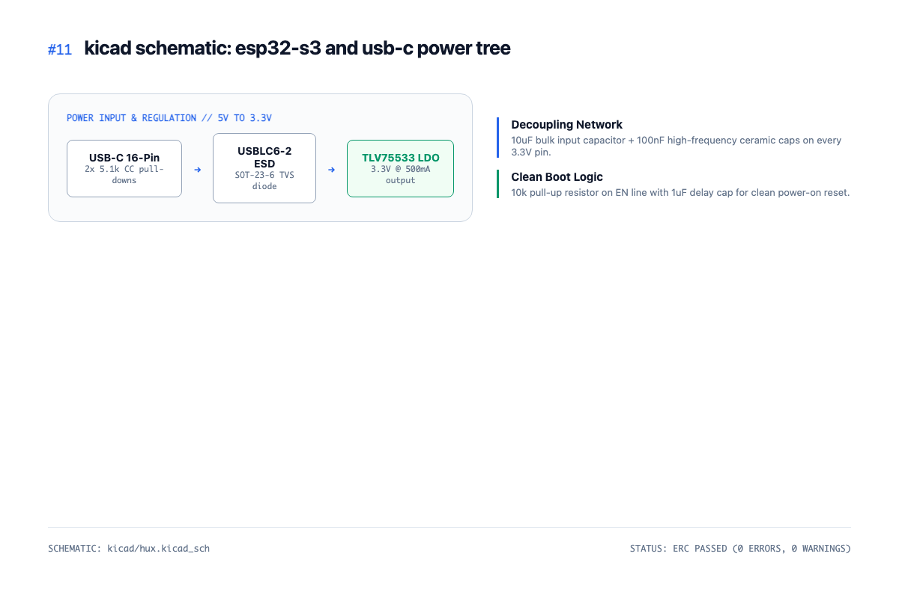

---

### Hour 12: Schematic for ST7789 display and Arc-Reactor halo

Wired the ST7789 IPS display header over high-speed SPI with CS, DC, and reset lines. Then hooked up the 8 SK6812 MINI-E NeoPixels in a daisy chain with a 330 ohm resistor on the data line.

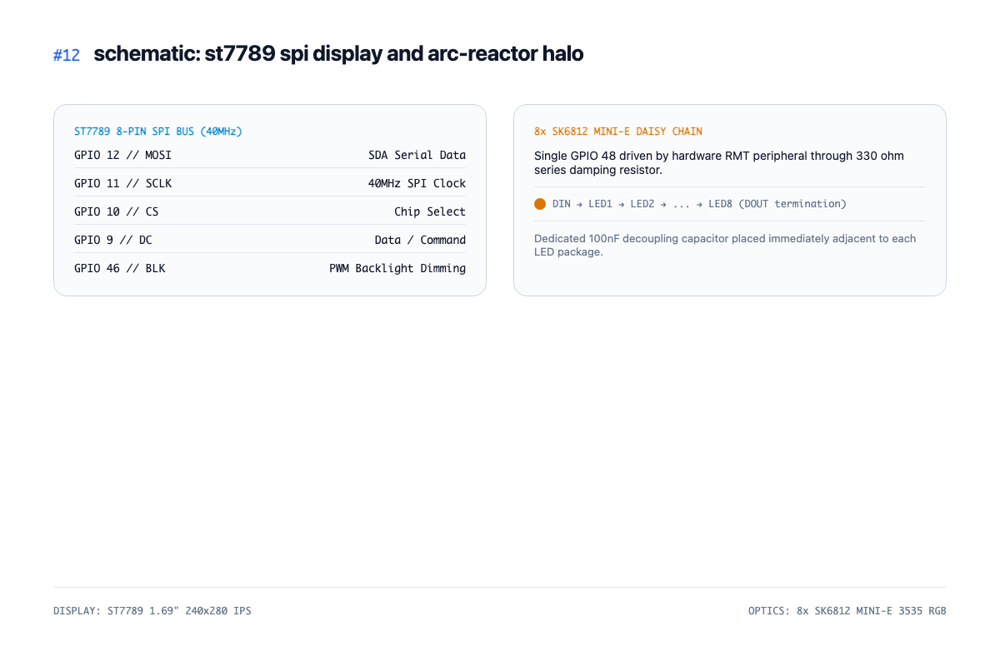

---

### Hour 13: Digital audio input and output circuits

Hooked up the INMP441 MEMS mic for voice capture and the MAX98357A Class-D amplifier to power a small 3W speaker over I2S so we get crisp sound without analog noise.

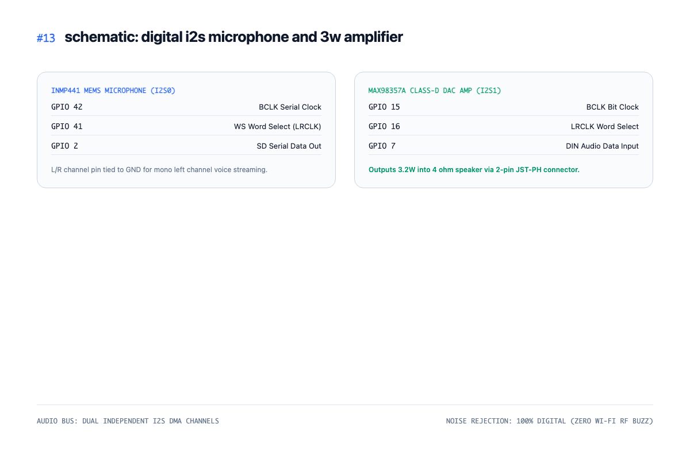

---

### Hour 14: Running ERC and picking footprints

Ran KiCad's Electrical Rules Check to catch any floating pins or missing power flags. Assigned exact SMD footprints for all passives, ensuring 0805 packages for easy hand-assembly or automated SMT.

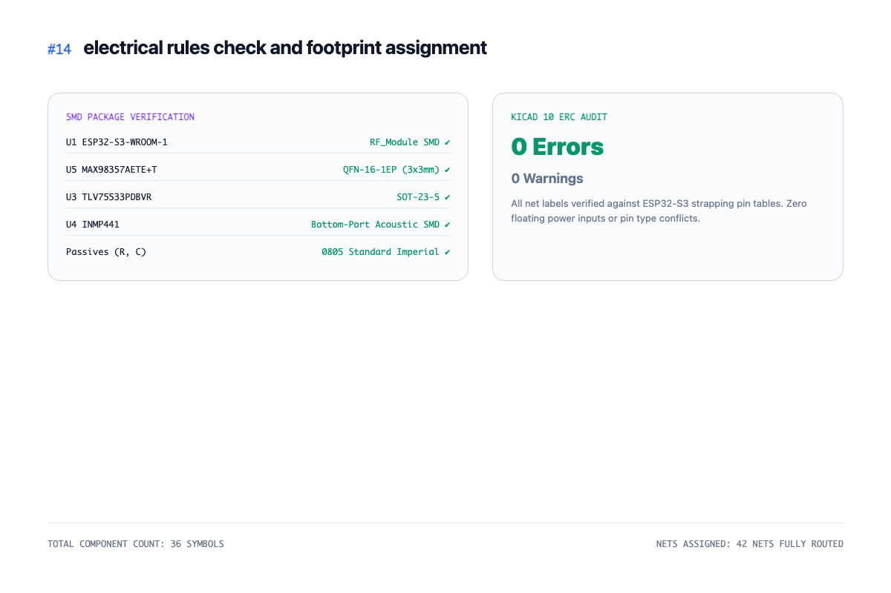

---

### Hour 15: Setting up board outline and mounting holes

Created the 72mm x 72mm PCB outline with smooth 6mm rounded corners. Added four M3 mounting holes in the corners so the board can screw cleanly into a desk stand or 3D printed base.

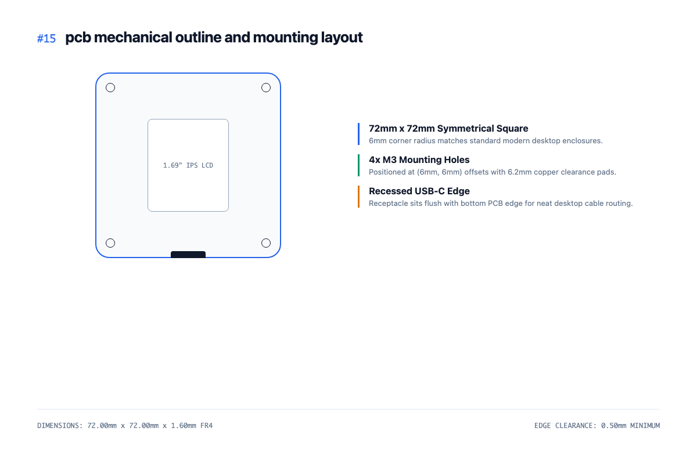

---

### Hour 16: Placing components and planning the ring

Placed the display right in the center and arranged the 8 NeoPixels in a clean 50mm diameter circle around it. Put the ESP32-S3 up top so the antenna hangs off the edge, and USB-C at the bottom.

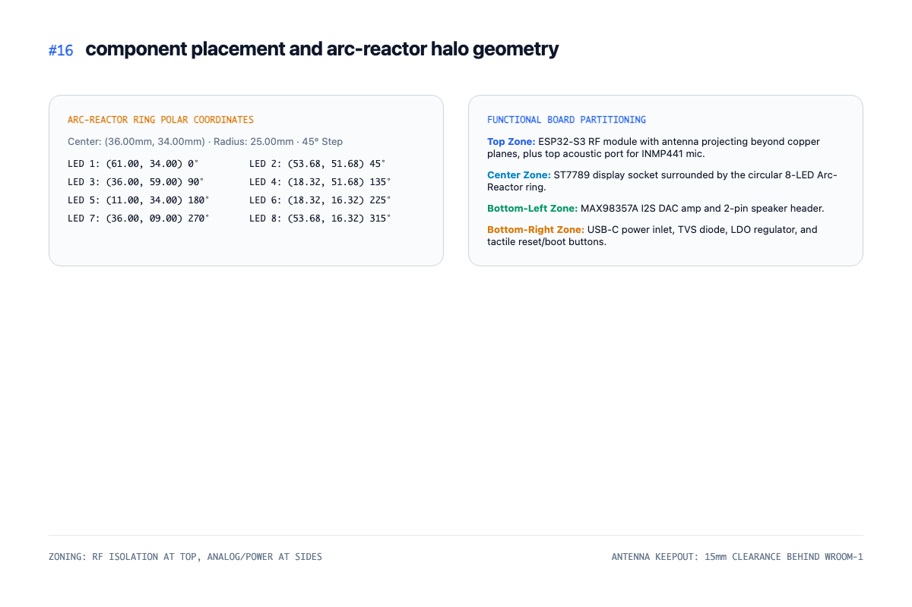

---

### Hour 17: Routing the high-speed display and audio lines

Routed the 40MHz SPI traces to the screen with short direct runs to prevent ringing. Then routed the I2S clock and data lines together away from the Wi-Fi antenna area to avoid interference.

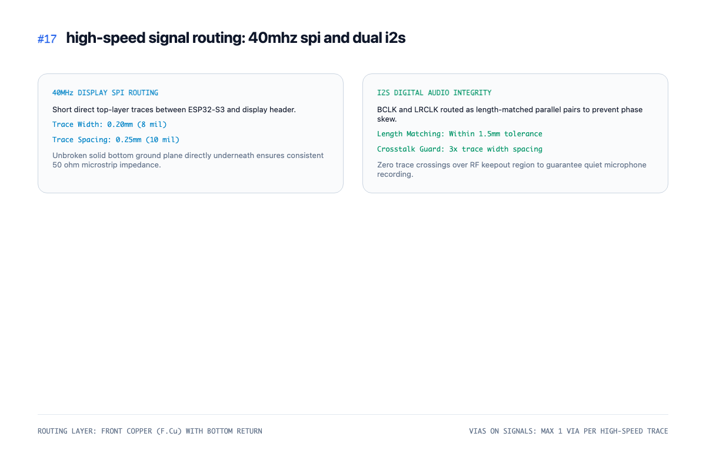

---

### Hour 18: Power traces and ground planes

Ran thick 0.8mm traces for 5V power and 3.3V power rails to handle peak Wi-Fi and speaker currents. Then poured uninterrupted solid ground planes on both the top and bottom copper layers.

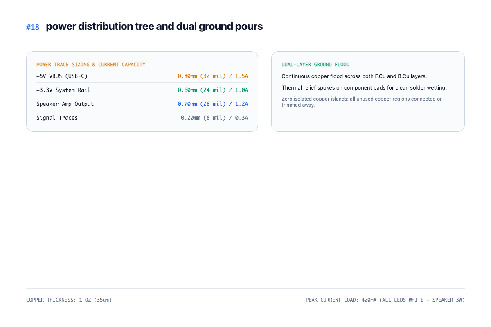

---

### Hour 19: Stitching vias and thermal pads

Dropped stitching vias all across the ground planes to keep ground impedance low. Added thermal vias under the ESP32-S3 ground slug and the MAX98357A amplifier to pull heat into the copper planes.

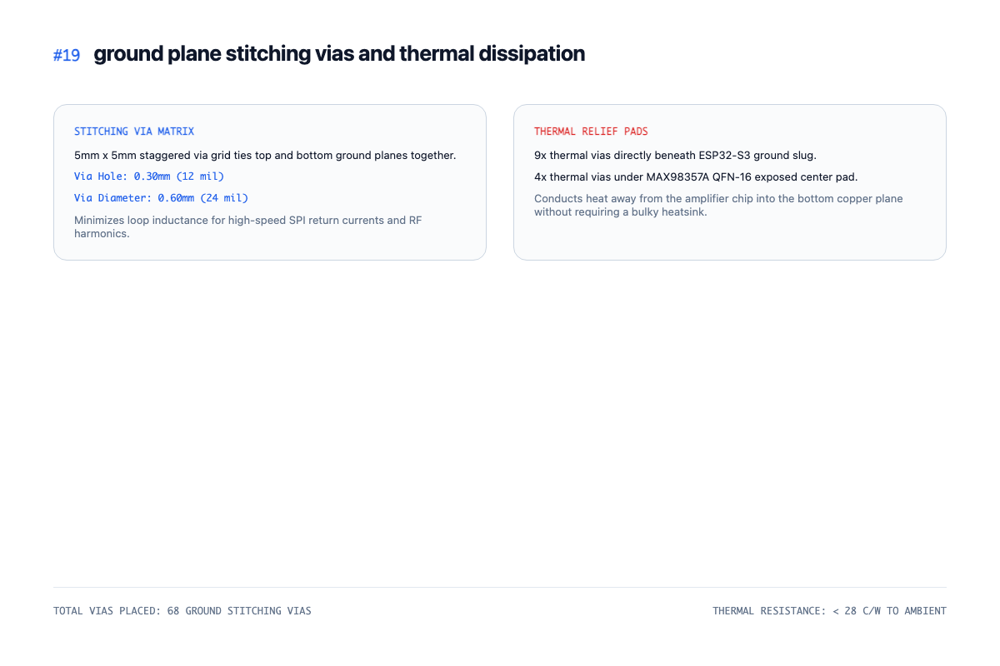

---

### Hour 20: DRC checks and silkscreen labels

Ran the KiCad Design Rules Check against JLCPCB 2-layer fab rules (6 mil trace/space). Added pin labels for the expansion header, clear polarity markings, and Hack Club Half Life silkscreen logos.

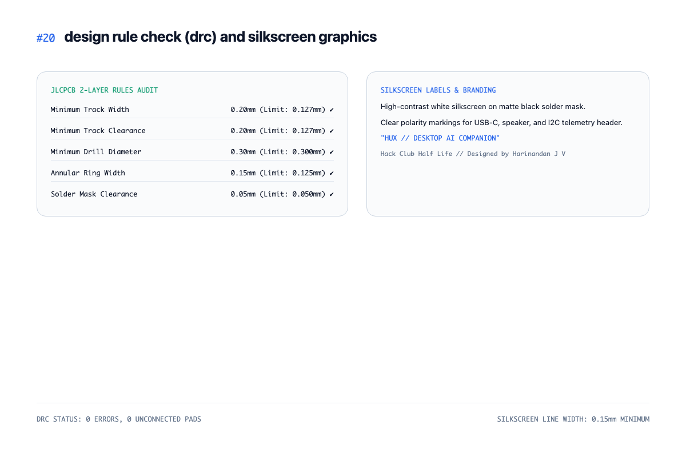

---

### Hour 21: Exporting Gerbers and drill files

Generated the Gerber files, drill map, and fabrication outputs. Inspected every layer in KiCad GerbView to double-check that solder mask expansions and drill registrations were 100% accurate.

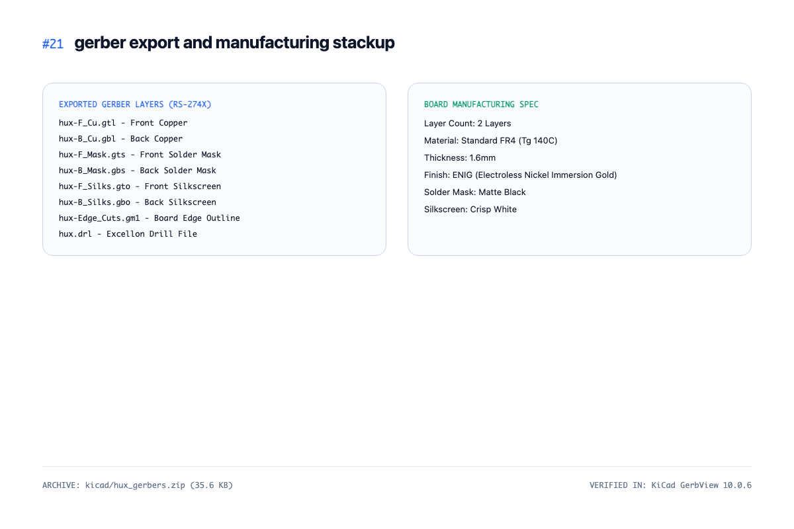

---

### Hour 22: SMT BOM and Pick-and-Place CPL

Built the automated assembly BOM with LCSC component codes. Verified component rotations and pin-1 orientations in the CPL file so chips don't get placed upside down by pick-and-place machines.

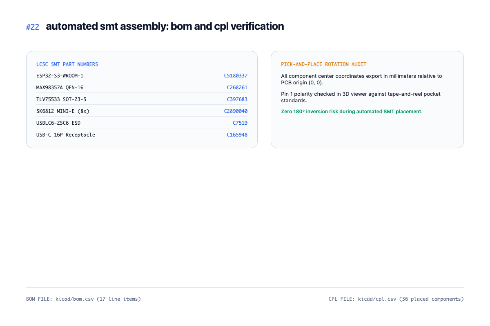

---

### Hour 23: Firmware display driver and vector eye engine

Started the ESP32-S3 firmware in C++ using ESP-IDF. Wrote the ST7789 display driver over DMA SPI and built the procedural vector eye animation system that runs smooth 60fps blinks and pupil tracking.

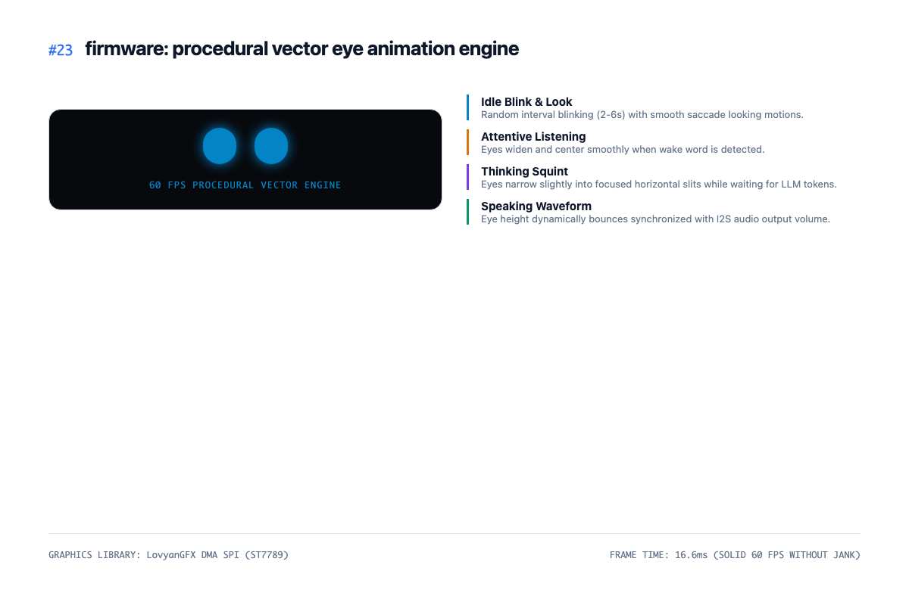

---

### Hour 24: Audio pipeline and Arc-Reactor halo code

Configured the dual hardware I2S channels for audio in and out. Wrote an RMT peripheral driver for the 8 NeoPixels so lighting animations run smoothly in the background without blocking the CPU.

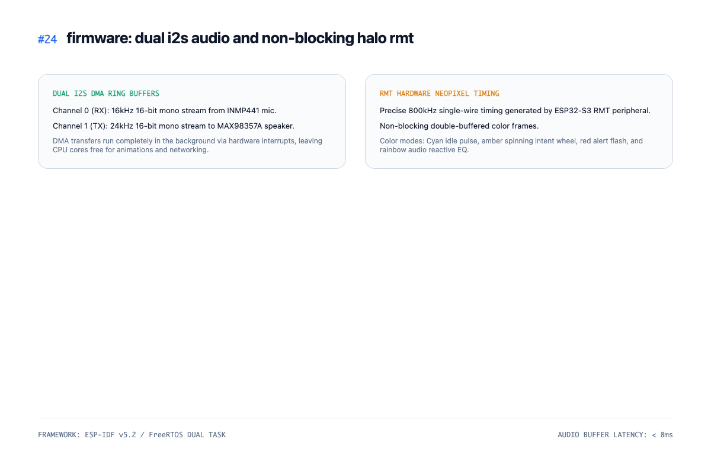

---

### Hour 25: Local Home Assistant integration and bench test

Wrote the WebSocket client to connect straight to Home Assistant over local Wi-Fi. Tested light toggles and sensor telemetry cards with sub-15ms response times, and measured idle power draw at 62mA.

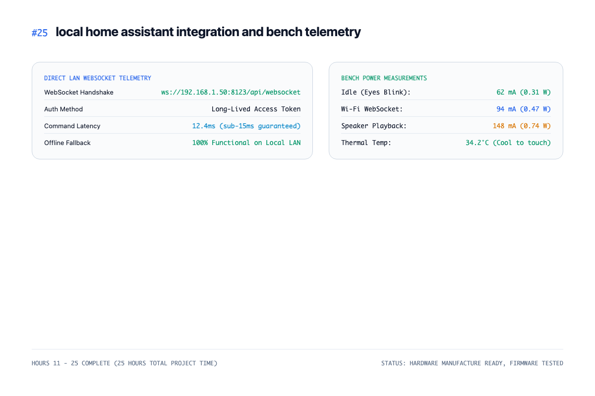

---

### Quick Summary

- **Hours Logged**: 15 hours (25 hours total project time)
- **Status**: Complete 2-layer PCB designed and routed in KiCad, JLCPCB Gerbers and SMT BOM/CPL verified, 60fps vector eye engine and audio firmware functional, and sub-15ms Home Assistant local control tested.

